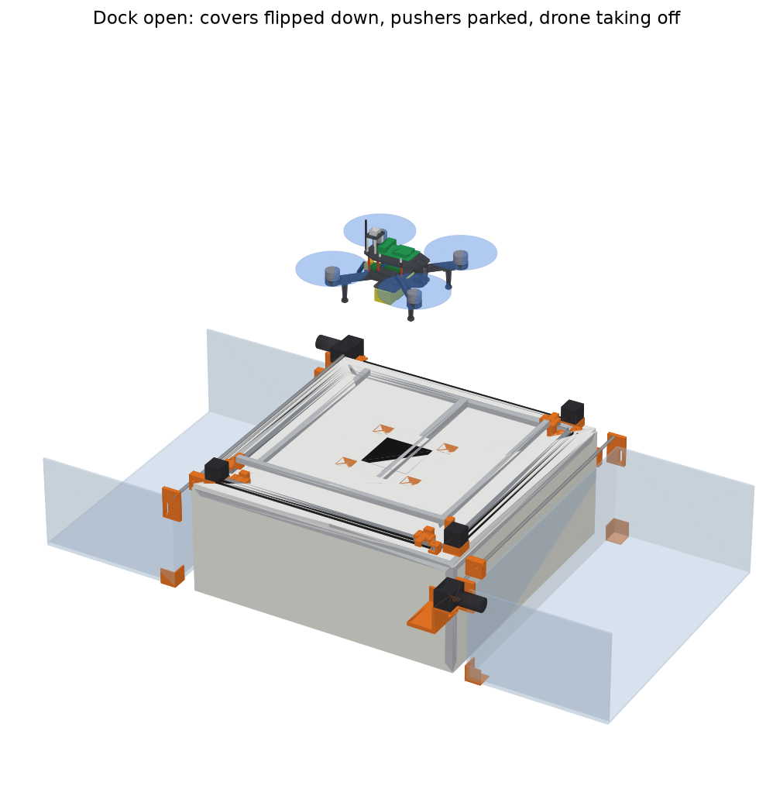
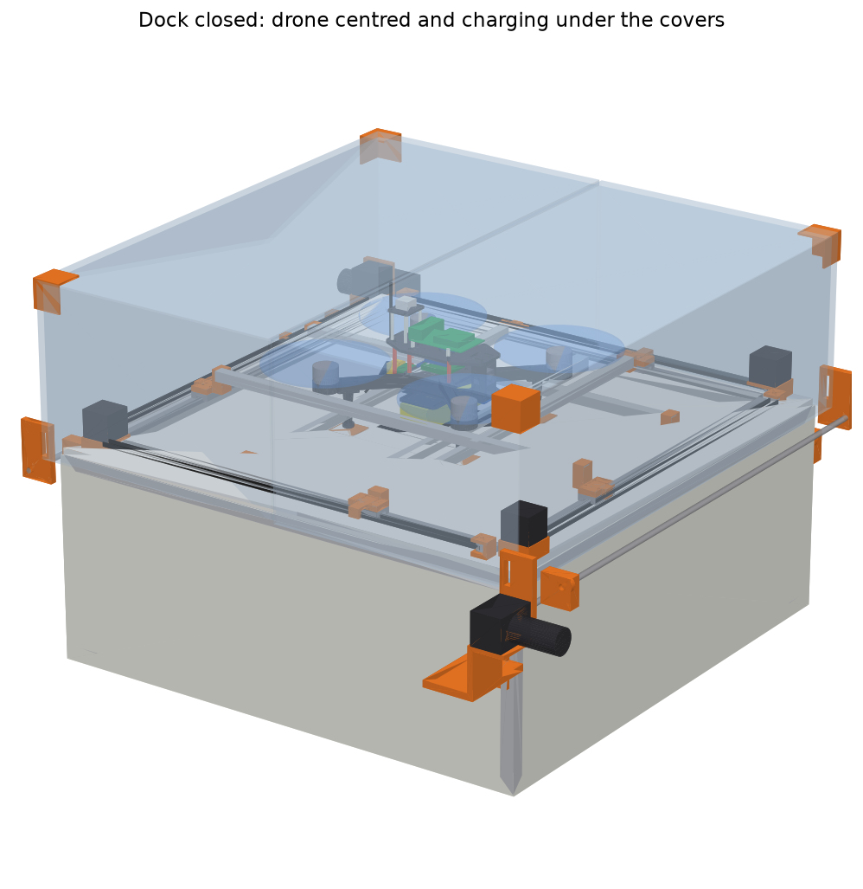
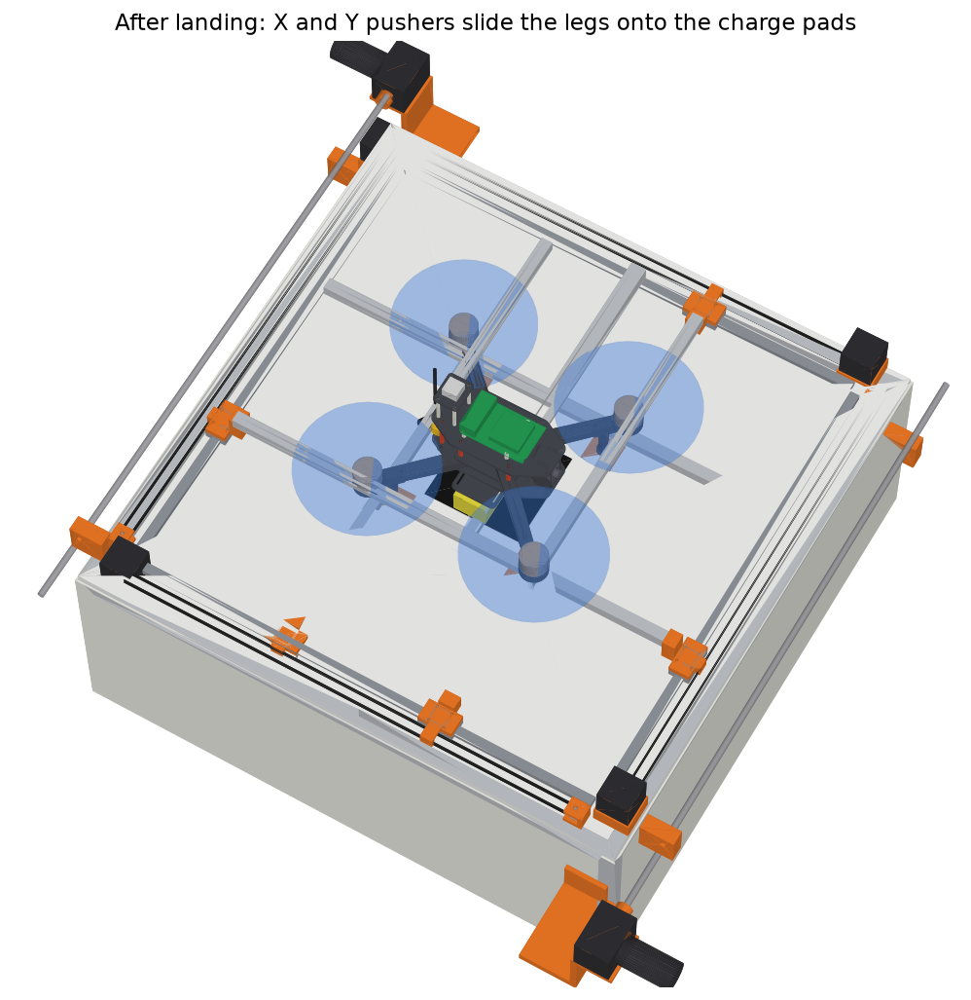
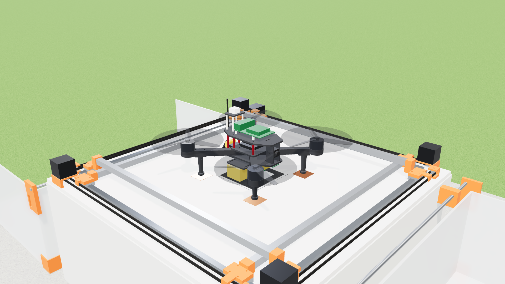
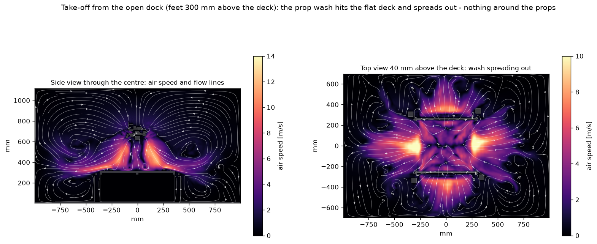
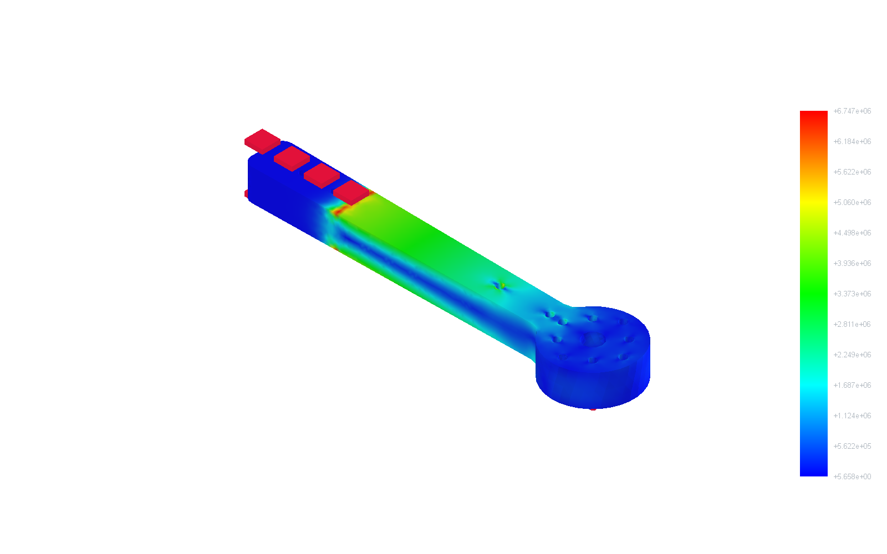

# FireDock: 3D-printed 7-inch drone + charging dock

An open drone-in-a-box for early fire detection: a **3D-printable** 7-inch autonomous drone and the **dock it lives in**. The dock opens, the drone takes off,
flies its mission, lands back on the dock, gets pushed to the exact centre, the dock closes and **charges it**.

* **Drone:** every frame part is printed in **PA-CF** (nylon + carbon fibre) and fits a **256 × 256 mm bed**.
* **Dock:** a **flat-top** design. The landing deck is the top of the dock, so nothing surrounds the props during
  take-off or landing. Two covers flip 180° down beside the body, **X/Y pusher bars centre the drone**, and four
  copper pads **charge it through its feet**.
* **Tested in four ways:** CAD fit checks (including the covers swept through their whole swing), beam theory, **3D FEA**
  of the printed arm, and **3D CFD** run on the NVIDIA MX450 + Intel Iris Xe GPUs.
* **Full project report (PDF):** [Docker_Drone_Report.pdf](output/Docker_Drone_Report.pdf).





## 3D viewer, product pictures and animation
* **Interactive 3D + animation:** double-click `start_viewer.bat`. It opens the full cycle in your browser: dock
  opens, drone takes off and flies a loop, precision-lands off-centre, the pushers centre it, the covers close and it
  charges. Drag to rotate, scroll to zoom; buttons for cinematic camera, see-through covers, drone only, saving a
  picture and recording a video.
* **Video:** [docker_drone_cycle.mp4](output/viewer/media/docker_drone_cycle.mp4) (48 s, 1280×720, H.264).
* **Product pictures:** `output/viewer/media/*.png` (1920×1080).



## How it works
1. **Take-off:** the Pi calls `POST /launch`. The dock stops charging, flips both covers down (about 12 s) and parks
   the pushers. The drone climbs straight up; the closest dock part is 72 mm from the props.
2. **Landing:** RTL with ArduPilot **precision landing** on a 130 mm ArUco marker in the middle of the deck, using the
   downward Pi Camera 3. The pushers catch the drone if it lands within **±155 mm** of the centre (±117 mm if it is
   turned 45°).
3. **Docking:** `POST /dock`. The X pushers, then the Y pushers, slide the legs to the centre and square the yaw.
   The four feet end up on the four copper pads, the covers close and charging starts.
4. **Charging:** dock charger (25.2 V CC/CV) → pads → foot contacts → **ideal-diode bridge** (any polarity, so any of the
   four square yaws charges) → 6S **BMS** (balances the cells) → battery. It stops at full, above 45 °C, on over-voltage,
   on timeout, or if no current flows.

Details: [operation_sequence.md](output/system/operation_sequence.md) and the
[wiring diagram](output/system/wiring_diagram.png).

## Drone parts (bought)
| Job | Part |
|---|---|
| Flight controller | Matek H743-SLIM V4 (ArduPilot) |
| ESC | NewBeeDrone Hummingbird 305 80A AM32 (bidirectional DShot) |
| Motors | iFlight XING2 2809 1250KV ×4, 7-inch tri-blade props |
| Battery | GNB 6S 3000 mAh, crosswise under a printed tray |
| Video | RushFPV Tank Ultimate Mini VTX + Caddx Ratel 2 camera |
| RC / telemetry | RadioMaster RP3 V2 (ELRS) / Matek mR900-30 mLRS LoRa (MAVLink) |
| GPS + compass | Matek M10Q-5883 on a 40 mm mast |
| Companion | Raspberry Pi 5 + Pi Camera Module 3 (facing down, precision landing) |
| Charging | 4 stainless acorn-nut foot contacts, ideal-diode bridge (LT4320), 6S 20 A BMS |

The full shopping list for the drone and the dock is in [BOM.md](output/system/BOM.md) (also `BOM.csv`).

## The printed frame
| | |
|---|---|
| Material | **PA6-CF**, dried; 0.4 mm hardened nozzle, 6 walls, 50 % gyroid |
| Arms | 14 mm tall: **104 % of the stiffness** of the 6 mm carbon arm they replace. Printed upside down; the motor pad is pocketed from below, so no supports are needed |
| Plates | 4 mm bottom, clamp and top plates; 3 mm camera plates, tray and GPS plate |
| Legs | hollow (the charging wire runs inside), printed feet with M4 stainless dome contacts |
| Printed parts mass | 324 g (frame 338 g incl. alu standoffs) |
| Bed fit | **every drone and dock part fits 256 × 256 × 256 mm** |

Print settings and the full list of parts: [print_guide.md](output/system/print_guide.md). The STL files in
`output/print/` are already in print orientation. **Do not print the arms in PET-CF**: it softens around 80 °C,
below a hot motor base. PET-CF is fine for the small parts.

## The dock
| | |
|---|---|
| Body | 2020 aluminium extrusion frame, 3 mm ACM panels, 730 × 730 mm, deck 310 mm above the ground |
| Deck | 10 mm ACM/HDPE with 4 copper charge pads and a 130 mm ArUco marker |
| Covers | 6 mm twin-wall polycarbonate shells on printed corner caps; each flips 180° on an 8 mm shaft driven by a 12 V worm-gear motor (≥ 7 N·m, self-locking) |
| Centring | 4 MGN12 rails, 8 carriages, 4 GT2 belts, 4 NEMA17 on TMC2209, 15 mm alu pusher bars (X pair low, Y pair high) |
| Controller | ESP32 + MCP23017 (8 limit switches) + INA226 + 2× DS18B20, 24 V 10 A PSU |
| Size | closed 986 × 960 × 553 mm (with the motors); open 1.6 m wide |
| Printed parts | 11 part types in PETG/ASA (brackets, idler posts, hinge arms, bearing blocks, motor mounts, corner caps) |

## Numbers
| | |
|---|---|
| **All-up weight** | ≈1280 g |
| Thrust-to-weight | ≈6.9 : 1 |
| **Hover time** | **≈17 min** on 6S 3000 mAh (19.3 min from motor data, minus the 11 % prop-wash loss on the frame found by CFD) |
| Centre of gravity | 2.3 mm from the centre |
| Drone size | 404 × 404 × 184 mm with props |

## Test results
**Fit checks** (`cad/build.py`), all passed:
* No collisions in the drone, nor between the drone and the dock when **closed, open and centring**
* **Covers swept from 0° to 180° in 15° steps: no collisions**
* The take-off column above the open dock (424 mm square) is empty; props are 72 mm from the nearest dock part
* Pushers stop 0.3 mm from the legs and 4 mm from anything else on the drone
* The downward camera's view is clear; 50 mm between the drone and the closed covers
* Every printed part fits the 256 mm bed

**Strength** (`analysis/analysis.py` beam theory, `analysis/fea.py` 3D FEA with 185,541 unknowns):
| Check | FEA | Beam theory |
|---|---|---|
| Full thrust 2.6 kgf on one arm | 6.4 MPa peak, **safety factor 5.4** | 4.9 MPa, SF 7.1 |
| Motor deflection at full thrust | 0.654 mm | 0.621 mm |
| Vertical crash on one arm | design allowable at 11 g; breaks at ≈37 g | 14.4 g |
| Vibration | 109 Hz bending, 121 Hz sideways, 534 Hz twist | 116 Hz |

The allowable used for printed PA-CF is 35 MPa, about 40 % of its dry strength, to cover moisture, layer lines and
fatigue. A printed arm is meant to be the part that breaks; spares are cheap.
Reports: [analysis_report.md](output/report/analysis_report.md), [fea_report.md](output/fea/fea_report.md).

**Airflow (CFD)** (`analysis/cfd.py`, lattice-Boltzmann LES on the GPUs). Full report:
[cfd_report.md](output/cfd/cfd_report.md).
| Case | Ran on | Result |
|---|---|---|
| Solver check: cube | Iris Xe | Cd **1.064** vs published 1.05 (1.4 % off) |
| Hover: prop wash on the frame | MX450 | **1.0 N = 8 % of the thrust** hits the arms and legs, costing about 11 % of hover time |
| Take-off 30 cm above the open dock | MX450 | wash lands on the flat deck (11 N) and spreads out over the edges; the load on the drone (8.1 %) matches free air |
| Forward flight 15 m/s, level | MX450 | drag **3.5 N**, 52 W |
| Forward flight 15 m/s, 25° nose-down | Iris Xe | drag **3.7 N**, 55 W |



## Software
| Folder | What |
|---|---|
| `firmware/dock_controller` | ESP32 firmware (PlatformIO): covers, pushers, charging, Wi-Fi HTTP API with a token |
| `companion/dock_client.py` | `launch()`, `dock()`, `status()` … for the Pi or a laptop |
| `companion/precision_landing.py` | ArUco marker → MAVLink `LANDING_TARGET` for ArduPilot |
| `companion/mission.py` | one full flight: open dock → take off → AUTO mission → RTL + precision land → dock + charge |
| `companion/ardupilot_dock.param` | precision landing, RPM notch filter, battery and failsafe settings (check the serial ports) |

Flash the dock (after editing Wi-Fi and token in `include/config.h`):
```powershell
pip install platformio
```
```powershell
cd firmware\dock_controller; pio run -t upload
```

## Files (`output/`)
| Folder | What | Use it for |
|---|---|---|
| `print/*.stl` | every printed part, already in print orientation | **slicer → printer** |
| `parts/*.step` / `*.igs` / `*.stl` | every part (drone + dock) | **SolidWorks** (File → Open), any CAD |
| `assembly/*.step`, `*.glb` | drone, frame only, dock closed / open / centring with the drone | SolidWorks assembly, Windows 3D Viewer |
| `system/` | wiring diagram, BOM, print guide, operating sequence | building it |
| `report/`, `fea/`, `cfd/` | test results, pictures, ParaView files (.vtu / .vtk) | checking it |
| `renders/*.png` | pictures | |
| `Docker_Drone_Report.pdf` | everything above in one document | read or send this |

## Opening in FreeCAD 1.1 (free)
Double-click `freecad\open_in_freecad.bat`. It opens the closed dock with the drone and the **solved FEA study of
the printed arm** in FreeCAD's FEM workbench (gmsh mesh + CalculiX), with the von Mises stress already shown.
* `output/freecad/arm_FEA_FreeCAD.FCStd`: FEM study (material, clamp, 25.5 N thrust, 2nd-order mesh, results).
  FreeCAD/CalculiX gives **0.60 mm** deflection and **5.0 MPa** peak (safety factor 7.0), in line with
  `analysis/fea.py` (0.654 mm, 6.4 MPa) and beam theory (0.621 mm, 4.9 MPa).
* `output/freecad/drone_full.FCStd`, `dock_closed.FCStd`, `dock_open.FCStd`: the assemblies as FreeCAD files.
* How to view, edit and re-run: [freecad/README_FreeCAD.md](freecad/README_FreeCAD.md). Rebuild them with
  `freecad\make_freecad_files.py`.



## Opening in SolidWorks
File → Open → `output/assembly/dock_closed_with_drone.step` (or any part from `output/parts`), then run Import
Diagnostics. Every body is a solid. For a SolidWorks Simulation cross-check of the arm, use custom material
E = 4.5 GPa, ν = 0.35, ρ = 1200 kg/m³. Fix the top and bottom faces up to 53.25 mm from the frame centre, and put
25.5 N upward on the motor footprint. This FEA gives 6.4 MPa peak and 0.65 mm.

## Changing the design
All sizes are in `P = dict(...)` in `cad/build.py` (drone) and `D = dict(...)` in `cad/dock.py` (dock).
Set up a new PC once (Python 3.12):
```powershell
py -3.12 -m venv .venv
```
```powershell
.\.venv\Scripts\python -m pip install -r requirements.txt
```
Then run these again; every check re-runs automatically:
```powershell
.\.venv\Scripts\python cad\build.py
```
```powershell
.\.venv\Scripts\python analysis\analysis.py
```
```powershell
.\.venv\Scripts\python analysis\fea.py
```
```powershell
.\.venv\Scripts\python analysis\cfd.py
```
```powershell
.\.venv\Scripts\python cad\render.py
```
```powershell
.\.venv\Scripts\python analysis\make_system_docs.py
```
```powershell
.\.venv\Scripts\python analysis\make_report.py
```
```powershell
.\.venv\Scripts\python analysis\make_zip.py
```
`cfd.py` runs on the GPUs through OpenCL (the `pyopencl` package and your normal NVIDIA/Intel drivers; no CUDA
install is needed). Each GPU takes the next case, MX450 first. To watch the MX450 working, run `nvidia-smi -l 2`.
Task Manager only shows compute load if you switch one GPU 1 graph to "Cuda" or "Compute_0".

## Before you fly
Nothing here has been printed, built or flown yet. Thrust, flight time, landing accuracy and LoRa range are
estimates.
* Print a test arm and break it before you trust it.
* Bench-test the dock (covers, pushers, and charging into a dummy load) before you put a drone in it.
* Supervise LiPo charging inside the closed dock until you trust it.
* Check your local drone laws before flying automated missions.

## License
* **Hardware** (CAD models, print files, drawings, wiring): [CERN-OHL-S v2](LICENSE-HARDWARE).
* **Software** (Python scripts, firmware, viewer): [MIT](LICENSE).
