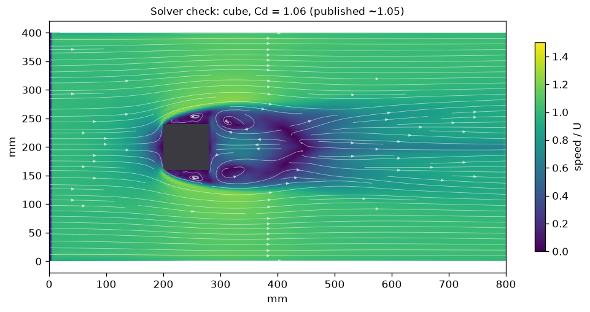
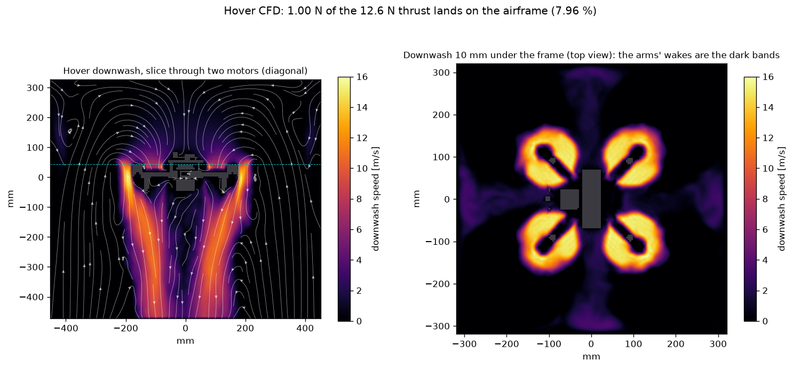
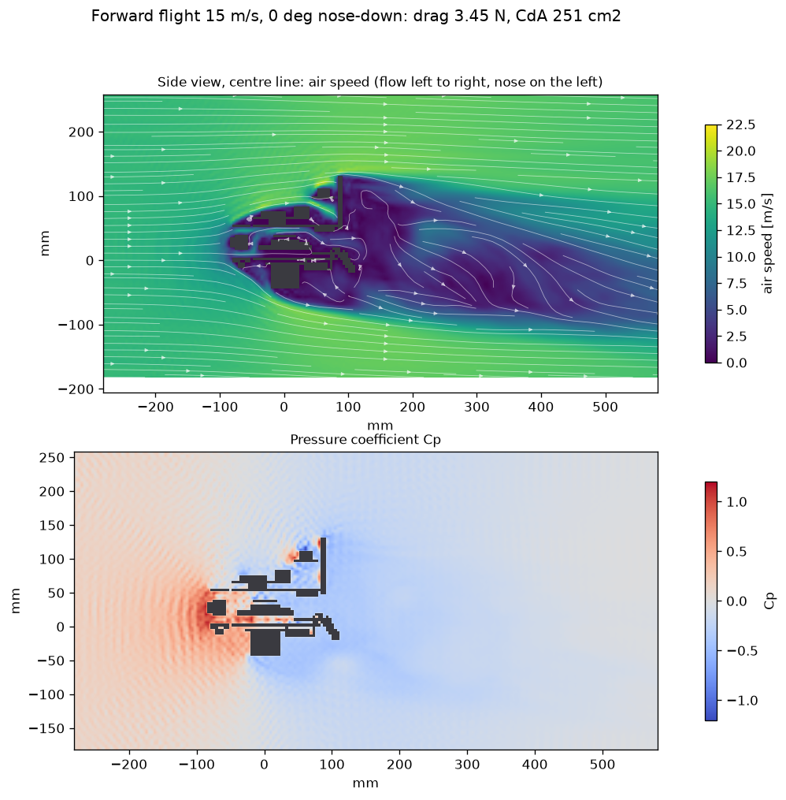
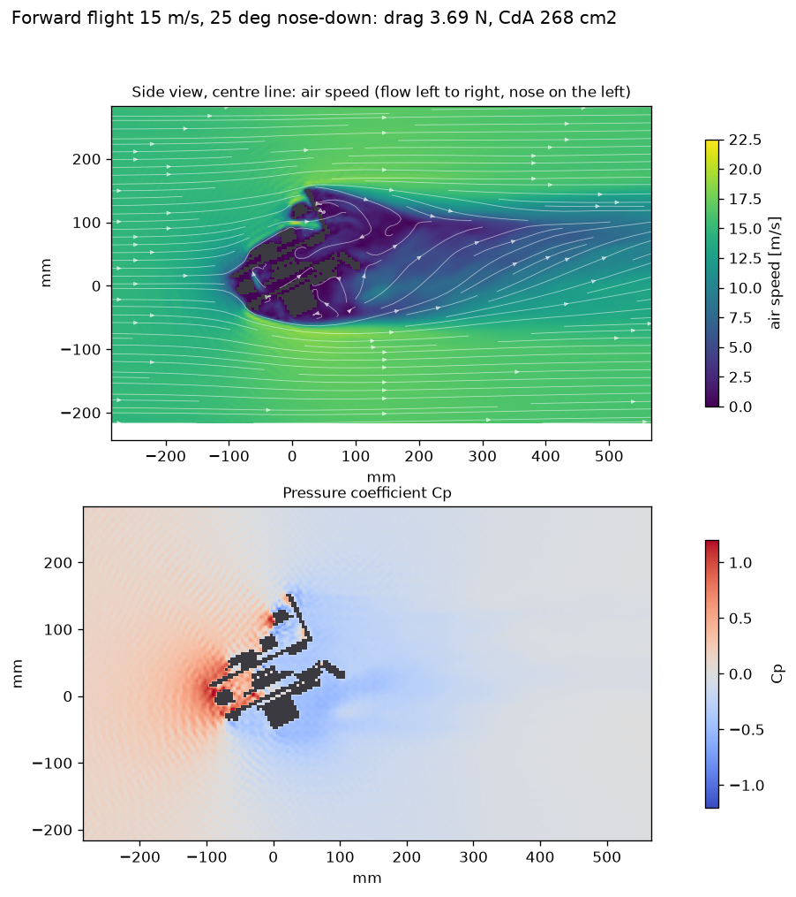
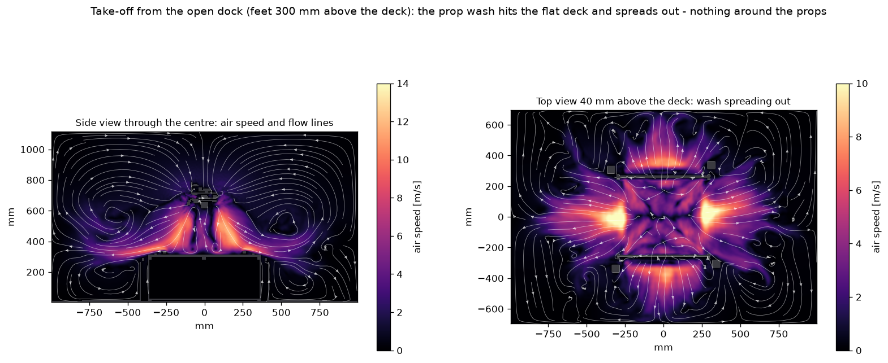

# CFD airflow simulation

Generated by `analysis/cfd.py`: 3D lattice-Boltzmann (D3Q19, BGK + Smagorinsky LES) on the real CAD geometry,
voxelised at 4 mm. Coarse LES gives indicative numbers (about ±20-30 %), so the solver is first checked
on a cube with a known drag coefficient.

## Solver check: cube
Cd = **1.064** vs published 1.05 (Hoerner, Fluid-Dynamic Drag (cube face-on)), error 1.4 %. 

## Hover: prop downwash on the frame
Each prop is an actuator disc carrying a quarter of the all-up weight. The downwash pushes on the arms, legs and
body; that force is thrust the motors make but the drone does not get.

| | |
|---|---|
| Thrust per motor | 3.14 N |
| Download on the airframe | **1.0 N = 7.96 % of thrust** |
| Effect on hover time | about −10.8 % |
| Induced velocity in the disc (CFD / momentum theory) | 6.74 / 7.19 m/s |

Typical quads lose 3–10 % this way. The 4 mm grid draws the arms and legs slightly wider and thicker
than they are, so this is a conservative (high) estimate. 

## Forward flight at 15 m/s (props removed)
| Attitude | Drag | CdA | Vertical force | Drag power |
|---|---|---|---|---|
| level | **3.454 N** | 251 cm² | 0.605 N | 51.8 W |
| 25° nose-down | **3.694 N** | 268 cm² | -0.5 N | 55.4 W |

Drag grows with speed squared (at 20 m/s: 6.14 N at 0°, 6.57 N at 25°).

## Take-off from the open dock
Drone hovering with its feet 300 mm above the deck, covers flipped down, pushers parked, ground below (8 mm cells).

| | |
|---|---|
| Total thrust | 12.57 N |
| Downward wash force on the drone | 1.018 N |
| Downward wash force on the dock | 10.961 N |
| Downward wash force on the ground | -0.076 N |
| Download on the drone near the deck | 8.1 % of thrust |
| Fastest wash 40 mm above the deck | 12.1 m/s |

The wash hits the flat deck and spreads outward over the edges and the open covers; there are no walls
to trap it and blow it back into the props. 

## Where each case ran
* cube: Intel(R) Iris(R) Xe Graphics, 4.3 min
* hover: NVIDIA GeForce MX450, 3.6 min
* ff0: NVIDIA GeForce MX450, 2.4 min
* ff25: Intel(R) Iris(R) Xe Graphics, 12.9 min
* dock_takeoff: NVIDIA GeForce MX450, 3.0 min

## Files
* `*_half_res.vtk`: time-averaged velocity, density and solid mask (every 2nd cell) for ParaView
* `cfd_results.json`: all numbers

## Limits
* 4 mm cells: plates and arms are a few cells thick, so small details are smoothed.
* Props are actuator discs (no blades, no swirl); in forward flight the props are left out.
* Free air only: ground effect and the dock walls during take-off are not included.
* Velocity is time-averaged over the last part of each run.